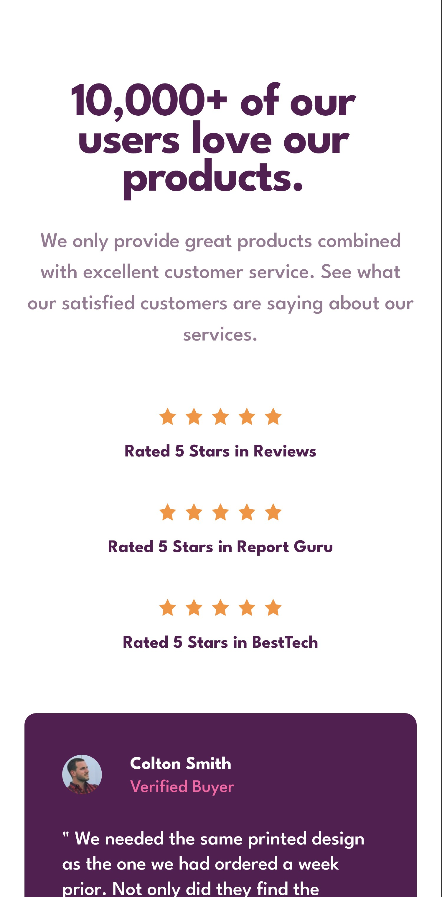
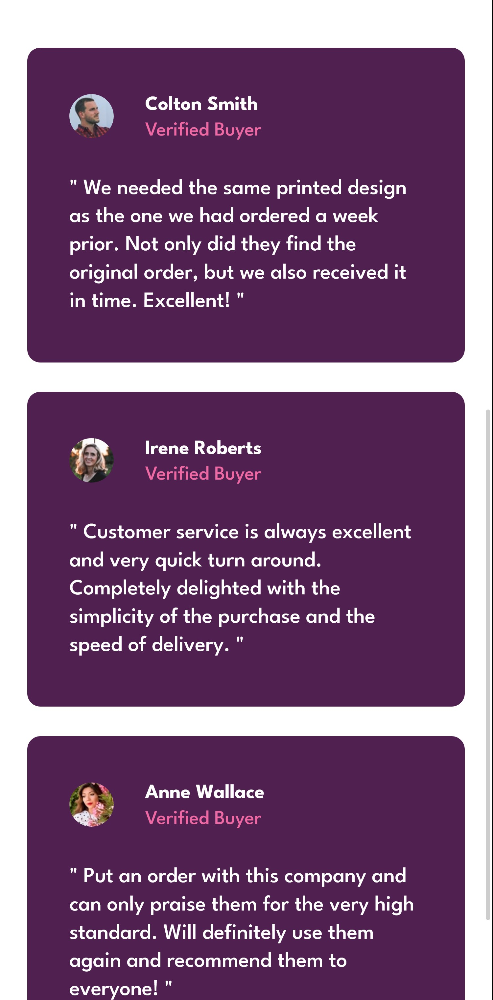

# 🌐 Social Proof Section

Solución al desafío **Social Proof Section** de [Frontend Mentor](https://www.frontendmentor.io).  
Este proyecto consiste en una landing page construida únicamente con **HTML** y **CSS**, aplicando **CSS Grid** y **CSS Flex** para la disposición de los elementos.

## **Desktop Design**


## **Mobile Design**




---

## 🚀 Instalación y Uso

1. Clona el repositorio:
   ```bash
   git clone https://github.com/silent-ax/fm-social-proof-section.git
   ```
2. Abre el archivo `index.html` en tu navegador favorito.

---

## 📂 Estructura del Proyecto

```markdown
- css/
- images/
- preview/
- .gitignore
- index.html
- LICENSE
- README.md
```

---

## 🎯 Objetivos del Proyecto

- Practicar **CSS Grid** y **CSS Flex** para crear layouts responsivos.
- Mejorar habilidades en **HTML semántico**.
- Replicar un diseño dado por Frontend Mentor.

---

## 🧪 Estado del Proyecto

✅ Completado  
📱 Responsivo en dispositivos móviles y escritorio

---

## ⚙️ Tecnologías

- HTML5
- CSS3 (Grid, Flexbox, Media Queries)

---

## 📄 Licencia

Este proyecto está bajo la licencia MIT.

---
